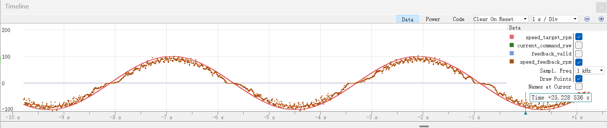
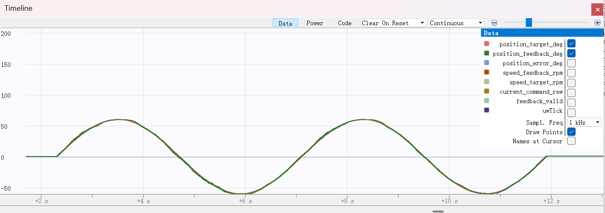

# GM6020 串级 PID 控制与调参效果

本项目基于 STM32F407 与 GM6020 电机，实现位置外环、速度内环的串级控制，并加入正弦轨迹速度前馈。控制任务由 TIM6 以 1 kHz 调用，通过 CAN1 控制 ID 为 1 的电机。

当前配置为速度环 `28 / 0.8 / 0.04`、位置环 `10 / 0 / 0`、速度前馈系数 `2`。


## 控制结构与当前参数

控制链路为：正弦位置目标 → 位置 PID → 叠加速度前馈 → 速度限幅 → 速度 PID → 电流指令 → 电机。位置和转速均来自 CAN 反馈。

| 项目 | 当前配置 |
| --- | --- |
| 控制周期 | 1 ms |
| 位置目标 | 以使能时的位置为中心，幅值 60°、周期 4 s |
| 位置外环 | Kp=10，Ki=0，Kd=0；输入为角度误差，输出为 rpm |
| 速度内环 | Kp=28，Ki=0.8，Kd=0.04；输入为转速误差，输出为原始电流指令 |
| 速度前馈 | 系数 2，按正弦位置目标解析求导 |
| 速度指令限幅 | ±60 rpm，前馈叠加后再次限幅 |
| 电流指令限幅 | ±1500 raw；按 16384 对应 3 A 换算约为 ±0.275 A |
| CAN 通信 | CAN1，1 Mbps；反馈标识符 0x205，电流控制标识符 0x1FE |
| 启动状态 | `control_enabled=0`，默认不使能控制 |
| 运行时限 | `tuning_limit_ms=0`，当前默认连续运行，直到禁用或故障 |

PID 使用位置式离散公式，采样周期 `Ts=0.001 s`：

```text
e[k] = 目标值 - 反馈值
u[k] = Kp × e[k] + Ki × Ts × Σe[j] + Kd × (e[k] - e[k-1]) / Ts
```

输出超过限幅时，撤销本拍积分累加，以抑制积分饱和。当前位置环实际上是纯 P 控制；速度环使用 PID。微分项直接对误差差分，未加入微分滤波。

速度前馈计算如下，其中 t 为本次使能后的轨迹时间，A=60°，T=4 s，Kff=2：

```text
位置目标 = 中心位置 + A × sin(2πt/T)
速度前馈[rpm] = Kff × A × (2π/T) × cos(2πt/T) / 6
```

除以 6 用于将度/秒换算为 rpm。系数 1 对应轨迹本身的运动学速度；系数 2 是本次空载实验选出的经验补偿，不能直接视为其他负载或周期下的最佳值。

## 速度内环调参效果

### 1. 测试配置
| 测试配置 | RMS 转速误差（rpm） | 最大绝对转速误差（rpm） | 反馈范围（rpm） | 输出饱和样本 |
| --- | --- | --- | --- | --- |
| PID=28/0.8/0.04 | 13.771 | 43.288 | -115～119 | 0/4000 |

**当前源码没有该独立速度模式、`control_mode` 变量或摩擦补偿实现。** 上表仅保留历史实验结论；当前位置串级控制仍使用速度 PID=28/0.8/0.04，不能把独立速度模式的优化参数直接当作当前固件配置，也不能只修改一个变量就复现该模式。

### 2. Ozone timeline曲线



## 位置环调参效果

### 1. 最终配置

最终配置为位置环 `10 / 0 / 0`（纯 P 控制），速度内环固定为 `28 / 0.8 / 0.04`，速度前馈系数 `2`。目标为 ±60°、4 秒周期的正弦轨迹，每组运行 8 秒，仅统计第二周期 4000 个控制采样点。

加入前馈后，RMS 位置误差为 **0.762°**，最大绝对位置误差为 **2.064°**；相对无前馈（RMS 2.280°、峰值 3.668°）分别降低约 **66.6%** 和 **43.7%**。

该结果来自本次空载测试，不是跨负载的误差保证；更换负载、摆幅或周期后需重新比较 RMS、峰值误差及电流输出。

### 2. Ozone timeline曲线



## 复现当前位置控制测试

1. 准备 CMake 3.22 或以上版本、Ninja 和 Arm GNU 工具链，执行：

   ```sh
   cmake --preset Debug
   cmake --build --preset Debug
   ```

2. 将新固件下载到开发板，并在调试器中加载匹配的 ELF 符号。确认电机已配置为本工程使用的电流控制模式，且允许执行对应摆幅的运动。
3. 保持 `control_enabled=0`，确认 `feedback_count` 持续增长、`feedback_valid=1`，记录 `control_tx_failures` 的起始值。
4. 设置 `position_kp`、`position_ki`、`position_kd`、`velocity_feedforward_gain`，并将 `tuning_limit_ms` 设置为 `8000`，使每组运行 8 秒。
5. 让固件至少执行一次禁用状态的控制周期，再设置 `control_enabled=1`。参数只在使能边沿锁存；重新使能会重置两个 PID、轨迹相位、统计量，并以当前位置作为轨迹中心。
6. 运行结束后确认 `control_enabled=0`、`tuning_samples=4000`，读取统计量并记录本轮反馈及发送状态。下一次使能会清除上一轮统计量。

位置参数合法范围为 Kp∈[0,10]、Ki∈[0,10]、Kd∈[0,1]，前馈系数∈[0,2]；非有限值或越界参数会导致控制被禁用。速度 PID 当前由源码固定，修改后需重新编译、下载。

固件内部统计公式为：

```text
RMS 位置误差 = sqrt(tuning_error_square_sum / tuning_samples)
最大绝对位置误差 = tuning_peak_error_deg
```

仅在 `tuning_samples > 0` 时计算 RMS。完整比较要求第二周期收满 4000 点；发生提前停机或反馈故障的测试不应当作完整有效样本。第二周期是统一比较窗口，并不自动证明系统已达到稳态。

| 观测变量 | 用途 |
| --- | --- |
| `position_target_deg` / `position_feedback_deg` | 比较位置目标与反馈曲线 |
| `position_error_deg` | 目标减反馈，单位为度 |
| `speed_target_rpm` / `speed_feedback_rpm` | 观察速度内环跟踪情况 |
| `current_command_raw` | 观察电流指令及是否接近 ±1500 限幅 |
| `tuning_samples` / `tuning_error_square_sum` / `tuning_peak_error_deg` | 读取固件内部第二周期统计结果 |
| `feedback_valid` / `feedback_age_ms` | 检查反馈是否新鲜有效 |
| `control_tx_failures` | 比较测试前后计数，判断有无新增发送异常 |


反馈超时超过 20 ms、CAN bus-off 或发送异常会禁用控制。反馈中断后重新接收时会重新建立位置零点，需要显式重新使能。禁用控制表示撤去驱动电流，不是主动制动。

## 代码与数据来源

| 路径 | 内容 |
| --- | --- |
| `Tasks/src/ControlTask.cpp` | 串级控制、轨迹、前馈、调参变量、误差统计与故障处理 |
| `Tasks/src/Pid.cpp` | PID 计算、输出限幅及积分回退 |
| `Tasks/inc/ControlTask.h` | 控制入口与主要观测变量声明 |
| `Core/Src/can.c` | CAN 初始化、收发及反馈分发 |
| `Tasks/src/Gm6020.cpp` | 电压模式协议封装；当前控制任务直接发送电流帧 |

